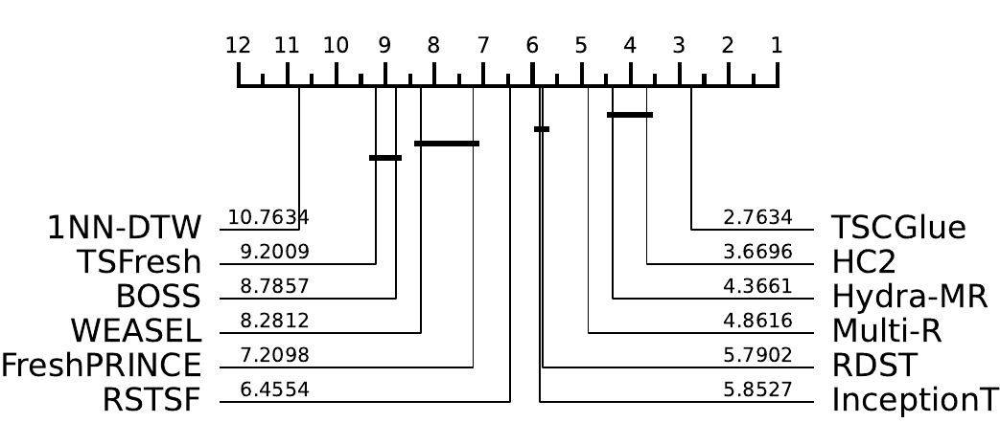

# TSCGlueClassifier

Automatic Time Series Classification library built on top of aeon and scikit-learn.

## Benchmark

Critical difference diagram evaluated on 112 univariate UCR datasets:



## Installation

```bash
# Base install (no PyTorch)
pip install tscglue

# Generic PyTorch (pip resolves version)
pip install "tscglue[torch]"

# CPU PyTorch (via uv)
uv pip install "tscglue[cpu]"

# CUDA 12.4 PyTorch (via uv)
uv pip install "tscglue[cu124]"

# CUDA 13.2 PyTorch (via uv)
uv pip install "tscglue[cu132]"
```

Neither CUDA build covers every card: `cu124` ships kernels for sm_50-sm_90, `cu132` for
sm_75-sm_120. Pick `cu132` for Blackwell (sm_120) and `cu124` for pre-Turing cards.

If you already have PyTorch installed, just install the base package — it won't reinstall torch.

## Quick Start

```python
from tscglue import utils
from tscglue.models import TSCGlueClassifier
from sklearn.metrics import accuracy_score

# Load a time series classification dataset
X_train, y_train, X_test, y_test = utils.load_dataset("ArrowHead")

# Create and train the model
model = TSCGlueClassifier(
    random_state=270,
    k_folds=10,
    n_jobs=-1
)
model.fit(X_train, y_train)

# Make predictions
y_pred = model.predict(X_test)
accuracy = accuracy_score(y_test, y_pred)
print(f"Accuracy: {accuracy:.4f}")
```

## Missing values

`X` may contain NaNs. `missing_values` sets how they are handled:

- `"impute_mask"` (default): each series is linearly interpolated (gaps at the start or end
  take the nearest observed value) and every channel that had a NaN in the training data
  gets an extra 0/1 mask channel (1 = observed, 0 = imputed). The masked channels are kept
  in `mask_channels_` and get their mask at predict time too. A channel that only has NaNs
  at predict time is imputed without a mask, with a warning. Training data without NaNs
  gets no mask, so it runs exactly as before.
- `"impute"`: interpolate only, no mask channels.
- `"error"`: raise a `ValueError` on any NaN.

Channels must be in the same order at fit and predict time.
